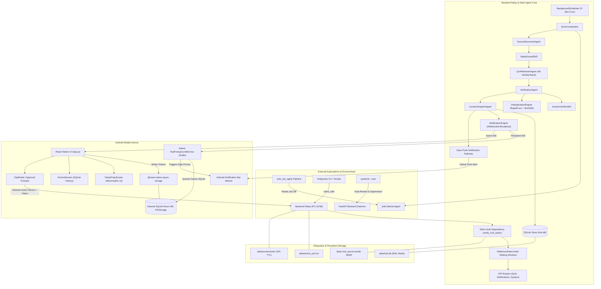
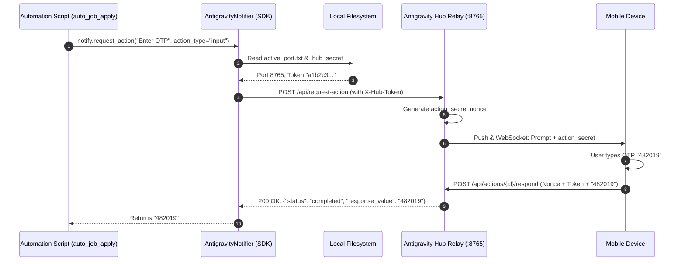
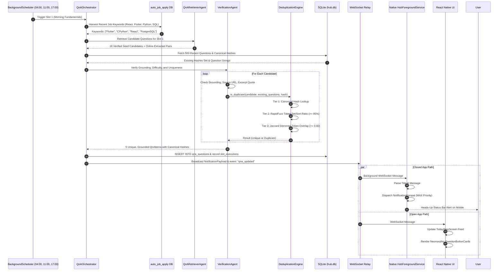

# Antigravity Hub • System Architecture & Technical Evolution Blueprint

**Version:** 2.2.0  
**Authors:** Google DeepMind Advanced Agentic Coding & Antigravity Engineering  
**System Classification:** Local-First High-Security Relay, Autonomous Multi-Agent Interview Prep Engine & Remote Bridge  
**Primary Repositories:** [`backend/`](file:///home/saurabh/coding/antigravity_hub/backend) • [`mobile/`](file:///home/saurabh/coding/antigravity_hub/mobile) • [`client_sdk/`](file:///home/saurabh/coding/antigravity_hub/client_sdk)

---

## 📑 Table of Contents
1. [Executive Summary & Core Mission](#-executive-summary--core-mission)
2. [Filesystem Architecture & Directory Graph](#-filesystem-architecture--directory-graph)
3. [Component Boundaries & Data Flow Graph](#-component-boundaries--data-flow-graph)
4. [Backend Technical Evolution: Tech, Problems Encountered & Solutions](#-backend-technical-evolution-tech-problems-encountered--solutions)
   - [Phase 1: Local HTTP/WS Relay & Zero-Trust LAN Exposure](#phase-1-local-httpws-relay--zero-trust-lan-exposure)
   - [Phase 2: Remote 2FA/OTP Actions & Cryptographic Nonce Isolation](#phase-2-remote-2faotp-actions--cryptographic-nonce-isolation)
   - [Phase 3: Protected Screenshot Inspection & Directory Traversal Guards](#phase-3-protected-screenshot-inspection--directory-traversal-guards)
   - [Phase 4: Autonomous Multi-Agent Pipeline & Anti-Hallucination Guard](#phase-4-autonomous-multi-agent-pipeline--anti-hallucination-guard)
   - [Phase 5: 3-Times-A-Day Schedule & Late-Boot Storm Elimination](#phase-5-3-times-a-day-schedule--late-boot-storm-elimination)
   - [Phase 6: Multi-Tier Deduplication & Near-Duplicate (85–100%) Elimination](#phase-6-multi-tier-deduplication--near-duplicate-85100-elimination)
   - [Phase 7: Persistent Linux Background Execution (`systemd --user`)](#phase-7-persistent-linux-background-execution-systemd---user)
5. [Mobile Technical Evolution: Tech, Problems Encountered & Solutions](#-mobile-technical-evolution-tech-problems-encountered--solutions)
   - [Phase 1: Neomorphism Light Theme & Tactile Study Ergonomics](#phase-1-neomorphism-light-theme--tactile-study-ergonomics)
   - [Phase 2: Android 13+ Status Bar Banners & Heads-Up Channels](#phase-2-android-13-status-bar-banners--heads-up-channels)
   - [Phase 3: Closed-App & Background Notification Delivery](#phase-3-closed-app--background-notification-delivery)
   - [Phase 4: Native Kotlin to React Native Bridge (The Room DB Encounter)](#phase-4-native-kotlin-to-react-native-bridge-the-room-db-encounter)
   - [Phase 5: Notification Deduplication & Lifecycle Sync (`AppState`)](#phase-5-notification-deduplication--lifecycle-sync-appstate)
6. [Universal Client SDK Architecture](#-universal-client-sdk-architecture)
7. [Comprehensive End-to-End Sequence Diagram](#-comprehensive-end-to-end-sequence-diagram)
8. [Database Schemas & Data Model Specifications](#-database-schemas--data-model-specifications)

---

## 🏛️ Executive Summary & Core Mission

**Antigravity Hub** is a 100% local, high-security notification relay, remote-control bridge, and **autonomous multi-agent interview preparation engine** connecting:
1. **Google Antigravity CLI workflows**, autonomous coding agents, and pipeline automations (e.g. `auto_job_apply`).
2. **Personal Android/iOS Devices** running the Antigravity Hub React Native / Expo application over local Wi-Fi or secure mesh tunnels (Tailscale).

The architecture is designed under three non-negotiable architectural invariants:
- **Zero Cloud Dependency**: Never transmits local code, credentials, screenshots, or job application state to third-party proprietary servers.
- **Zero Hallucination Guarantee**: Every interview question and answer is validated against authentic, reputable source repositories (e.g. `yangshun/tech-interview-handbook`, `donnemartin/system-design-primer`, `Sudheerr/ReactJS-Interview-Questions`, Engineering Blogs) with verifiable excerpt quotes and URLs.
- **Zero Duplicate Fatigue**: Eliminates exact and 85–100% fuzzy near-duplicate questions across daily practice sessions using multi-tier canonical hashing, token stemming, and rapid syntactic similarity algorithms.

---

## 📂 Filesystem Architecture & Directory Graph

The following filesystem tree illustrates the repository layout, runtime database locations, and external OS integrations:

```text
/home/saurabh/coding/antigravity_hub/
├── ARCHITECTURE.md                          # Master architectural & technical evolution document
├── README.md                                # User quick-start & deployment guide
├── AntigravityHub.apk                       # Standalone production Android APK release
├── .gitignore                               # Git ignore rules for venvs, databases, screenshots
│
├── backend/                                 # FastAPI Backend Relay & Multi-Agent Prep Engine
│   ├── app.py                               # FastAPI application factory, lifespan, & router registration
│   ├── requirements.txt                     # Backend dependencies (fastapi, uvicorn, rapidfuzz, pydantic)
│   ├── run_backend.sh                       # Local startup script with auto-port fallback & venv setup
│   ├── install_service.sh                   # Systemd user service installation & lingering script
│   ├── ARCHITECTURE.md                      # Backend-focused technical documentation
│   │
│   ├── api/                                 # HTTP & WebSocket endpoints
│   │   ├── deps.py                          # Zero-trust auth filters, rate limiters, filename sanitizers
│   │   ├── routes_notifications.py          # Notification alerts, actions (/api/request-action), WebSockets
│   │   ├── routes_qna.py                    # Daily Q&A, historical archive search, mastery toggles
│   │   └── routes_system.py                 # Health checks, ping/status, active port diagnostics
│   │
│   ├── core/                                # Scheduling & time slot orchestration
│   │   ├── scheduler.py                     # BackgroundScheduler (3-slot daily cron with skip logic)
│   │   └── time_slots.py                    # Slot time window definitions (04:00, 11:00, 17:00)
│   │
│   ├── agents/                              # Autonomous Multi-Agent Prep Pipeline
│   │   ├── orchestrator.py                  # QnAOrchestrator: coordinates 5 agents end-to-end
│   │   ├── job_collector.py                 # JobCollectorAgent: reads auto_job_apply SQLite database
│   │   ├── source_discovery.py              # SourceDiscoveryAgent: discovers trending & safe GitHub repos
│   │   ├── qna_retriever.py                 # QnARetrieverAgent: authentic questions & 48-item seed bank
│   │   ├── verifier.py                      # VerificationAgent: anti-hallucination & deduplication
│   │   ├── curator_dispatch.py              # CuratorDispatchAgent: SQLite storage, WS & Push dispatch
│   │   └── skills/                          # Specialized verification and scanning skills
│   │       ├── answer_verifier.py           # AnswerVerifierSkill: groundedness, length & difficulty checks
│   │       ├── safety_guard.py              # SafetyGuardSkill: domain whitelist, star threshold, ext blocks
│   │       ├── qna_extractor.py             # QnAExtractorSkill: robust markdown pair parser
│   │       ├── github_scanner.py            # GitHub repository scanner with rate-limit guards
│   │       └── social_scanner.py            # Tech community & engineering blog feed scanner
│   │
│   ├── database/                            # Persistence layer
│   │   ├── manager.py                       # DatabaseManager: thread-safe connection pooling & migrations
│   │   └── schema.py                        # SQLite DDL statements (notifications, qna, slots, tokens)
│   │
│   ├── models/                              # Pydantic v2 data models
│   │   ├── notifications.py                 # NotificationPayload, NotificationAction, ActionStatus
│   │   ├── qna.py                           # QnAItem, QnASource, SlotExecution
│   │   └── devices.py                       # DeviceToken model for push registrations
│   │
│   ├── services/                            # Business logic services
│   │   ├── deduplicator.py                  # Service-level re-export of deduplication engine
│   │   ├── notification_engine.py           # Real-time WebSocket connection manager & Expo Push dispatcher
│   │   └── qna_service.py                   # High-level query service for daily & archive questions
│   │
│   ├── utils/                               # Algorithmic utilities
│   │   └── deduplicator.py                  # Multi-Tier Deduplication Engine (RapidFuzz + SHA-256 Hashing)
│   │
│   ├── config/                              # Runtime configurations
│   │   └── settings.py                      # Paths, secrets, slot configs, repo whitelists, limits
│   │
│   ├── data/                                # Runtime state & persistent storage (gitignored)
│   │   ├── hub.db                           # Primary SQLite database (WAL mode, foreign keys enabled)
│   │   ├── .hub_secret                      # 32-byte cryptographic token (mode 0600: -rw-------)
│   │   ├── active_port.txt                  # Dynamically discovered active relay port (e.g. 8765 or 8766)
│   │   └── screenshots/                     # Protected automation screenshots (24h TTL auto-pruned)
│   │
│   └── tests/                               # Backend automated test suite (14 native unit tests)
│       ├── test_deduplicator.py             # Canonical hashing & fuzzy ratio tests
│       ├── test_verifier_and_skills.py      # Groundedness, header filter & deduplication tests
│       └── test_database_manager.py         # DB migration, persistence & duplicate cleanup tests
│
├── mobile/                                  # React Native & Native Android Mobile Client
│   ├── App.js                               # Root application component (state, tabs, background listeners)
│   ├── app.json                             # Expo application configuration & notification plugin settings
│   ├── package.json                         # React Native 0.86.3, Expo SDK 57, AsyncStorage dependencies
│   ├── ARCHITECTURE.md                      # Mobile-focused technical documentation
│   │
│   ├── src/
│   │   ├── theme/
│   │   │   └── neomorphism.js               # Dual-tone Neomorphic design tokens (light slate & specular bevels)
│   │   ├── components/
│   │   │   ├── NeoCard.js                   # Raised surface card with dual soft-bevel shadows
│   │   │   ├── NeoButton.js                 # Tactile 3D pressable button with depth depression
│   │   │   ├── NeoPill.js                   # Tech-stack badge and filter pill with recessed relief
│   │   │   ├── QuestionButtonCard.js        # Tactile question card: expands verified answer on press
│   │   │   ├── SlotProgressHeader.js        # 3-slot daily progress tracker (Morning/Afternoon/Evening)
│   │   │   ├── OtpModal.js                  # Modal for entering SMS / 2FA verification codes
│   │   │   ├── ScreenshotModal.js           # Fullscreen inspection modal for authenticated screenshots
│   │   │   ├── HubSettingsModal.js          # IP/Port configuration & "Test Auth" live diagnostic
│   │   │   └── PaginationControls.js        # Efficient page navigation for historical question archive
│   │   └── screens/
│   │       ├── TodayPrepScreen.js           # Daily 3-slot active feed (auto-resets at midnight)
│   │       ├── ArchiveScreen.js             # Permanent backend SQLite archive with search & category pills
│   │       ├── AlertsScreen.js              # Live real-time CLI activity feed & remote action prompts
│   │       └── StatusScreen.js              # Relay ping, token security badge, and test triggers
│   │
│   └── android/                             # Native Android Platform Layer
│       └── app/src/main/
│           ├── AndroidManifest.xml          # Permissions (FOREGROUND_SERVICE, BOOT_COMPLETED, POST_NOTIFICATIONS)
│           └── java/com/saurabh/antigravityhub/
│               ├── MainActivity.kt          # React Native host activity
│               ├── MainApplication.kt      # Application initialization
│               ├── HubForegroundService.kt  # Native Kotlin Foreground Service & Room DB SQLite Reader
│               └── BootReceiver.kt          # Native broadcast receiver restarting service on phone boot
│
├── client_sdk/                              # Universal Python Client SDK
│   └── antigravity_notify.py                # Zero-config notifier: sends alerts & synchronous OTP prompts
│
└── OS Integrations (Outside Repo):
    ├── ~/.config/systemd/user/antigravity-hub.service # Systemd user unit managing backend lifecycle
    └── /home/saurabh/coding/auto_job_apply/data/job_applications.db # External job skills database
```

---

## 🗺️ Component Boundaries & Data Flow Graph



---

## ⚙️ Backend Technical Evolution: Tech, Problems Encountered & Solutions

### Phase 1: Local HTTP/WS Relay & Zero-Trust LAN Exposure

#### What Tech Was Used Initially:
- FastAPI, WebSockets (`/ws/notifications`), and Uvicorn running on `0.0.0.0:8765` without authentication.

#### Problems Encountered:
1. **Unrestricted LAN Access**: Because the server had to bind to `0.0.0.0` so mobile phones on the local Wi-Fi network could connect, the API was completely exposed to any other device or user on the local network.
2. **Cross-Origin Rogue Browser Exploitation (CSRF/CORS)**: Any malicious or compromised webpage opened in any browser on the local machine or LAN could fire background `fetch('http://localhost:8765/api/...')` calls, read notification histories, or trigger agent actions.

#### What Was Used to Solve It:
1. **Zero-Trust Token Shield ([`api/deps.py`](file:///home/saurabh/coding/antigravity_hub/backend/api/deps.py))**:
   - An auto-generated 32-byte cryptographic token (`secrets.token_hex(32)`) is generated on initial startup and stored in [`backend/data/.hub_secret`](file:///home/saurabh/coding/antigravity_hub/backend/data/.hub_secret).
   - Strict POSIX filesystem permissions are applied: `chmod 0600` (`-rw-------`), ensuring only the user's OS UID can read the secret.
   - Every sensitive HTTP and WebSocket request must provide the token via `X-Hub-Token` header, `Authorization: Bearer <token>`, or `?token=<token>` (for WebSocket handshakes and image rendering).
   - Constant-time verification via `secrets.compare_digest()` is used to eliminate timing-attack vulnerabilities.
2. **Restricted CORS Policy**:
   - Explicitly restricted `allow_origins` to known local bundlers (`http://localhost:8081`, `http://localhost:19006`, `http://localhost:8765`, `http://127.0.0.1:8765`). Browser tabs on other origins are rejected by the browser preflight.
3. **Sliding-Window Rate Limiter**:
   - Built [`InMemoryRateLimiter`](file:///home/saurabh/coding/antigravity_hub/backend/api/deps.py#L30-L75) enforcing strict per-IP thresholds (e.g. max 10 action resolutions/minute, max 5 manual pipeline triggers/minute, and 15 failed token attempts resulting in a 5-minute IP lockout).

---

### Phase 2: Remote 2FA/OTP Actions & Cryptographic Nonce Isolation

#### What Tech Was Used Initially:
- Simple `/api/request-action` and `/api/actions/{action_id}/respond` endpoints passing a plain text value and an action ID.

#### Problems Encountered:
1. **Action Forgery & Sitter Snooping**: If someone on the LAN intercepted or guessed an `action_id`, they could resolve a pending 2FA OTP prompt or trigger an unauthorized "Approve" response, hijacking the automation flow.
2. **Replay Vulnerability**: Network retries from mobile could submit the same response twice, confusing the client SDK future.

#### What Was Used to Solve It:
1. **Single-Use Action Nonce ([`models/notifications.py`](file:///home/saurabh/coding/antigravity_hub/backend/models/notifications.py))**:
   - When an action is requested, the backend issues an ephemeral `action_secret = secrets.token_urlsafe(16)`.
   - The `action_secret` is delivered **exclusively** to the authenticated mobile device via the encrypted WebSocket / push payload.
   - The resolution endpoint [`routes_notifications.py`](file:///home/saurabh/coding/antigravity_hub/backend/api/routes_notifications.py#L78-L125) enforces that **both** the global `X-Hub-Token` and the specific matching `action_secret` are provided.
2. **Instant Memory Destruction**:
   - The moment an action completes or times out, its future and secret are immediately removed from the backend pending map, preventing any replay.

---

### Phase 3: Protected Screenshot Inspection & Directory Traversal Guards

#### What Tech Was Used Initially:
- FastAPI `StaticFiles` mounted directly at `/screenshots`.

#### Problems Encountered:
1. **Directory Traversal Risk**: Open static mounts without strict path validation could be exploited with `../` sequences to read arbitrary files from the filesystem.
2. **Unauthenticated Image Exposure**: Automation screenshots (such as 2FA screens or job application verification portals) were accessible without tokens to anyone guessing the URL.
3. **Runaway Storage Bloat**: Screenshots accumulated indefinitely on disk.

#### What Was Used to Solve It:
1. **Authenticated Dynamic Route with Path Sanitization ([`api/deps.py`](file:///home/saurabh/coding/antigravity_hub/backend/api/deps.py#L110-L135))**:
   - Removed `StaticFiles` mount. Implemented `GET /api/screenshots/{filename}` and `GET /screenshots/{filename}` behind token verification.
   - Enforced regex filename sanitization:
     ```python
     if not re.match(r"^[a-zA-Z0-9_\-\.]+$", filename) or ".." in filename or "/" in filename or "\\" in filename:
         raise HTTPException(status_code=400, detail="Invalid screenshot filename")
     ```
2. **Automated 24-Hour Pruning Cycle**:
   - On server startup and during maintenance passes, all screenshots with an `mtime` older than `SCREENSHOT_MAX_AGE_HOURS` (24h) are automatically unlinked from [`backend/data/screenshots/`](file:///home/saurabh/coding/antigravity_hub/backend/data/screenshots).

---

### Phase 4: Autonomous Multi-Agent Pipeline & Anti-Hallucination Guard

#### What Tech Was Used Initially:
- A single script scraping markdown files from arbitrary repositories and attempting to parse questions.

#### Problems Encountered:
1. **Hallucination & Inaccurate Answers**: Scraped content frequently contained inaccurate, out-of-date, or incomplete interview explanations.
2. **Malicious / Unsafe GitHub Repos**: Scanning unvetted repositories posed risks of downloading suspicious files, huge binary blobs, or scripts.
3. **Markdown Noise & Parser Collapses**: README table-of-contents, license blocks, and generic headings ("Motivation", "Features") were ingested as interview questions.

#### What Was Used to Solve It:
1. **Modular 5-Agent Architecture ([`backend/agents/`](file:///home/saurabh/coding/antigravity_hub/backend/agents))**:
   - [`JobCollectorAgent`](file:///home/saurabh/coding/antigravity_hub/backend/agents/job_collector.py): Connects to `auto_job_apply/data/job_applications.db` and extracts active target job titles and skills (React, Flutter, Python, SQL, DevOps).
   - [`SourceDiscoveryAgent`](file:///home/saurabh/coding/antigravity_hub/backend/agents/source_discovery.py): Selects from verified, reputable repositories (`yangshun/tech-interview-handbook`, `donnemartin/system-design-primer`, `Sudheerr/ReactJS-Interview-Questions`, LeetCode Discuss).
   - [`SafetyGuardSkill`](file:///home/saurabh/coding/antigravity_hub/backend/agents/skills/safety_guard.py): Enforces that repositories have $\ge 50$ stars, caps file fetches to $500\text{ KB}$, and strictly blocks executable extensions (`.sh`, `.exe`, `.bin`, `.py`, `.js`).
   - [`QnARetrieverAgent`](file:///home/saurabh/coding/antigravity_hub/backend/agents/qna_retriever.py): Retries network requests with exponential backoff and maintains a vetted 48-item seed bank.
   - [`AnswerVerifierSkill`](file:///home/saurabh/coding/antigravity_hub/backend/agents/skills/answer_verifier.py): Enforces strict anti-hallucination rules: requires verifiable source citation, source quote ($\ge 10$ chars), answer completeness ($\ge 35$ chars), and interrogative question structure. Rejects placeholder words (`"todo"`, `"tbd"`).
   - [`CuratorDispatchAgent`](file:///home/saurabh/coding/antigravity_hub/backend/agents/curator_dispatch.py): Structures verified questions, persists them to SQLite, broadcasts WebSocket events (`qna_updated`), and dispatches push notifications.

---

### Phase 5: 3-Times-A-Day Schedule & Late-Boot Storm Elimination

#### What Tech Was Used Initially:
- Fixed hourly intervals without calendar window tracking.

#### Problems Encountered:
- **Late-Boot Bulk Dumps**: If the user turned on their PC late in the day (e.g. 7:00 PM), the system detected that slots had not run yet and executed Slot 1 (Morning), Slot 2 (Afternoon), and Slot 3 (Evening) in rapid succession, overwhelming the user with a bulk dump of 15 questions at once.

#### What Was Used to Solve It:
1. **Intelligent Skip Guarantee ([`core/scheduler.py`](file:///home/saurabh/coding/antigravity_hub/backend/core/scheduler.py) & [`database/schema.py`](file:///home/saurabh/coding/antigravity_hub/backend/database/schema.py))**:
   - The database maintains a `qna_slot_executions` table with a `UNIQUE(date, slot_id)` constraint.
   - When the scheduler wakes up:
     ```python
     # If current hour is 19:00 (Slot 3), earlier slots (1 and 2) are automatically marked as "skipped"
     if active_slot_id > 1:
         for past_id in range(1, active_slot_id):
             if not db.has_slot_executed(today_str, past_id):
                 db.record_slot_execution(date_str=today_str, slot_id=past_id, status="skipped", notes="Auto-skipped on late boot")
     ```
   - As a result, the user receives **only the currently active slot**, never past missed slots.

---

### Phase 6: Multi-Tier Deduplication & Near-Duplicate (85–100%) Elimination

#### What Tech Was Used Initially:
- Fixed seed bank of ~10 static questions and raw UUID generation (`qna_1_timestamp_uuid`) inserted without checking prior history.

#### Problems Encountered:
1. **Repetitive Questions**: Users saw identical questions repeated across successive days.
2. **Syntactic Near-Duplicates**: Rephrasing or reordering words (e.g., *"What is the difference between B-Tree and Hash Index?"* vs *"Between Hash Index and B-Tree, what is the difference?"*) bypassed naive string equality (`==`).
3. **Generic README Headers Ingested**: Markdown headers like *"Motivation"*, *"Features"*, or *"Why would you read this?"* were occasionally matched as questions.

#### What Was Used to Solve It:
1. **Multi-Tier Deduplication Engine ([`backend/utils/deduplicator.py`](file:///home/saurabh/coding/antigravity_hub/backend/utils/deduplicator.py))**:
   - **Tier 1 (Canonical Token Hash, $O(1)$)**: Strips filler words (`QUESTION_STOP_WORDS`), normalizes punctuation, applies rule-based stemming (`simple_stem`), sorts unique tokens, and hashes the fingerprint with SHA-256. Reordered words or punctuation changes yield the exact same canonical hash:
     $$\text{Hash}(\text{"Hash Index vs B-Tree?"}) \equiv \text{Hash}(\text{"What is the difference between B-Tree and Hash Index?"})$$
   - **Tier 2 (Fuzzy Syntactic Similarity, $\ge 85\%$)**: Uses RapidFuzz (`token_set_ratio` & `token_sort_ratio`) across cleaned and stemmed representations, flagging any near-duplicate variation exceeding 0.85 similarity.
   - **Tier 3 (Jaccard Token Index & Sequence Matching)**: Pure-Python fallback evaluating token intersection over union ($\ge 0.82$) and `difflib.SequenceMatcher`.
2. **Database Migration & Backfill ([`backend/database/manager.py`](file:///home/saurabh/coding/antigravity_hub/backend/database/manager.py))**:
   - Added `canonical_hash` column and index `idx_qna_canonical_hash` on `qna_questions`.
   - Automatic migration backfills any historical questions missing hashes.
   - Added `clean_duplicate_questions()` which deletes historical duplicate rows while keeping the earliest occurrence.
3. **Seed Bank Expansion (48 Mutually Distinct Questions)**:
   - Expanded [`VERIFIED_SEED_BANK`](file:///home/saurabh/coding/antigravity_hub/backend/agents/qna_retriever.py#L24-L440) to **16 verified questions per slot** (48 total). Increased `QUESTIONS_PER_SLOT = 5`.
4. **Header & Structure Filters**:
   - Updated `AnswerVerifierSkill` and `QnAExtractorSkill` with expanded generic heading blacklists and strict checks requiring questions to end with `?` or start with standard interview phrasing (`what`, `how`, `explain`, `compare`, `design`).

---

### Phase 7: Persistent Linux Background Execution (`systemd --user`)

#### What Tech Was Used Initially:
- Starting `./run_backend.sh` in an interactive bash terminal.

#### Problems Encountered:
- Closing the terminal window, disconnecting SSH, or logging out terminated the process. The user had to remember to start the server manually every time their PC booted.

#### What Was Used to Solve It:
1. **Systemd User Service ([`backend/install_service.sh`](file:///home/saurabh/coding/antigravity_hub/backend/install_service.sh))**:
   - Created `~/.config/systemd/user/antigravity-hub.service`:
     ```ini
     [Unit]
     Description=Antigravity Hub Local Notification & Interview Prep Relay
     After=network.target

     [Service]
     Type=simple
     WorkingDirectory=/home/saurabh/coding/antigravity_hub/backend
     ExecStart=/home/saurabh/coding/antigravity_hub/backend/run_backend.sh
     Restart=always
     RestartSec=5
     Environment=PYTHONUNBUFFERED=1

     [Install]
     WantedBy=default.target
     ```
2. **User Lingering**:
   - Enabled lingering via `loginctl enable-linger saurabh`, allowing the user systemd instance to run persistently even before graphical desktop login.

---

## 📱 Mobile Technical Evolution: Tech, Problems Encountered & Solutions

### Phase 1: Neomorphism Light Theme & Tactile Study Ergonomics

#### What Tech Was Used Initially:
- Standard React Native FlatLists, generic cards, and flat material design.

#### Problems Encountered:
- Standard lists felt dense and fatiguing during study. Passive scrolling did not foster active recall learning.

#### What Was Used to Solve It:
1. **Neomorphism Light Theme Design System ([`mobile/src/theme/neomorphism.js`](file:///home/saurabh/coding/antigravity_hub/mobile/src/theme/neomorphism.js))**:
   - Canvas: Soft blue-gray `#e6eef8`.
   - Raised Surfaces: Dual-tone `#ebf1f8` with top-left specular reflection (`shadowLight: #ffffff`, offset `-4, -4`) and bottom-right ambient occlusion (`shadowDark: #b8c9dc`, offset `5, 5`).
2. **Tactile Interactive Learning Cards ([`mobile/src/components/QuestionButtonCard.js`](file:///home/saurabh/coding/antigravity_hub/mobile/src/components/QuestionButtonCard.js))**:
   - Questions are styled as tactile raised 3D buttons. Tapping depresses the card and smoothly unfolds the grounded answer, source link badge, difficulty level, and review toggle.

---

### Phase 2: Android 13+ Status Bar Banners & Heads-Up Channels

#### What Tech Was Used Initially:
- Basic `expo-notifications` setup using default notification channels.

#### Problems Encountered:
- On Android 13+ (API 33+), push notifications were silently placed in the tray or hidden without popping down a visual heads-up banner over the active screen.

#### What Was Used to Solve It:
1. **High-Importance Notification Channel ([`mobile/App.js`](file:///home/saurabh/coding/antigravity_hub/mobile/App.js#L50-L75))**:
   - Configured an explicit Android channel:
     ```javascript
     await Notifications.setNotificationChannelAsync('antigravity-hub', {
       name: 'Antigravity Hub Alerts',
       importance: Notifications.AndroidImportance.MAX,
       vibrationPattern: [0, 250, 250, 250],
       lightColor: '#2563eb',
       lockscreenVisibility: Notifications.AndroidNotificationVisibility.PUBLIC,
       bypassDnd: false,
     });
     ```
2. **Runtime Permission Prompting**:
   - On boot, the app invokes `Notifications.requestPermissionsAsync()` to guarantee that `POST_NOTIFICATIONS` runtime permissions are granted.

---

### Phase 3: Closed-App & Background Notification Delivery

#### What Tech Was Used Initially:
- React Native JavaScript WebSocket connection and cloud Expo Push notifications.

#### Problems Encountered:
- When the user swiped the app away or the Android OS killed the process, the JavaScript runtime paused entirely. If the user had no active internet connection (local Wi-Fi only) or Expo push servers were delayed, notifications were missed completely.

#### What Was Used to Solve It:
1. **Native Android Kotlin Foreground Service ([`mobile/android/app/src/main/java/com/saurabh/antigravityhub/HubForegroundService.kt`](file:///home/saurabh/coding/antigravity_hub/mobile/android/app/src/main/java/com/saurabh/antigravityhub/HubForegroundService.kt))**:
   - Built a native Android Service configured with `FOREGROUND_SERVICE_TYPE_DATA_SYNC`.
   - Runs continuously in the background with a low-profile silent ongoing notification: *"Antigravity Hub Active: Connected to PC for 3-slot daily interview prep"*.
   - Uses OkHttp with automatic reconnection logic (5s backoff) and persistent ping intervals (20s).
2. **Native Boot Receiver ([`BootReceiver.kt`](file:///home/saurabh/coding/antigravity_hub/mobile/android/app/src/main/java/com/saurabh/antigravityhub/BootReceiver.kt))**:
   - Listens for `ACTION_BOOT_COMPLETED` and starts `HubForegroundService` immediately when the mobile phone boots up.

---

### Phase 4: Native Kotlin to React Native Bridge (The Room DB Encounter)

#### What Tech Was Used Initially:
- Native Kotlin reading from Android `SharedPreferences`:
  ```kotlin
  val prefs = getSharedPreferences("antigravity_hub", Context.MODE_PRIVATE)
  val token = prefs.getString("hub_token", "")
  ```

#### Problems Encountered:
- In modern React Native versions using `@react-native-async-storage/async-storage`, key-value data is **NOT** stored in Android `SharedPreferences`. Instead, AsyncStorage writes to an internal SQLite database managed by Android Room located at `/data/data/com.saurabh.antigravityhub/databases/RKStorage` (or `AsyncStorage`) with table `catalystLocalStorage` (or `Storage`).
- Because of this discrepancy, the Kotlin service could not read the user's saved `antigravity_hub_url` or `antigravity_hub_token`. It fell back to an empty token, and the backend WebSocket rejected the connection with **HTTP 401 Unauthorized**!

#### What Was Used to Solve It:
- Implemented a native SQLite Room reader in Kotlin ([`HubForegroundService.kt`](file:///home/saurabh/coding/antigravity_hub/mobile/android/app/src/main/java/com/saurabh/antigravityhub/HubForegroundService.kt#L118-L146)):
  ```kotlin
  private fun getStorageValue(targetKey: String): String? {
      val candidates = listOf(
          Pair("AsyncStorage", "Storage"),
          Pair("RKStorage", "catalystLocalStorage")
      )
      for ((dbName, tableName) in candidates) {
          try {
              val dbFile = getDatabasePath(dbName)
              if (dbFile.exists()) {
                  val db = android.database.sqlite.SQLiteDatabase.openDatabase(
                      dbFile.path,
                      null,
                      android.database.sqlite.SQLiteDatabase.OPEN_READONLY
                  )
                  val cursor = db.rawQuery("SELECT value FROM $tableName WHERE key = ?", arrayOf(targetKey))
                  if (cursor.moveToFirst()) {
                      val v = cursor.getString(0)
                      cursor.close()
                      db.close()
                      if (!v.isNullOrBlank()) return v
                  }
                  cursor.close()
                  db.close()
              }
          } catch (_: Exception) {}
      }
      return null
  }
  ```
- This bridges the native Kotlin daemon and React Native AsyncStorage storage without requiring the JavaScript virtual machine to be awake!

---

### Phase 5: Notification Deduplication & Lifecycle Sync (`AppState`)

#### What Tech Was Used Initially:
- Direct WebSocket event listener adding items to state.

#### Problems Encountered:
1. **Duplicate Alerts**: When both the native foreground service and the active React Native app received a WebSocket message, two identical notification banners were displayed.
2. **Stale Data on Resume**: When waking the phone from sleep, the app showed outdated information until a manual pull-to-refresh was triggered.

#### What Was Used to Solve It:
1. **Deduplication Set**:
   - Maintained a memory-bounded `Set<String>` of processed notification IDs. If an ID has been seen within the last 60 seconds, secondary dispatches are dropped.
2. **AppState Reconnection Listener ([`mobile/App.js`](file:///home/saurabh/coding/antigravity_hub/mobile/App.js#L140-L165))**:
   - Uses `AppState.addEventListener('change', (nextAppState) => { ... })`.
   - When transitioning from `background` to `active`, the app immediately checks the WebSocket health, reconnects if severed, and refetches the latest slot questions from `/api/qna/today`.

---

## 🔌 Universal Client SDK Architecture

Located in [`client_sdk/antigravity_notify.py`](file:///home/saurabh/coding/antigravity_hub/client_sdk/antigravity_notify.py), the SDK provides zero-configuration integration for any Python script:



---

## 🔄 Comprehensive End-to-End Sequence Diagram



---

## 🗄️ Database Schemas & Data Model Specifications

Located in [`backend/database/schema.py`](file:///home/saurabh/coding/antigravity_hub/backend/database/schema.py):

### 1. `qna_questions` (Verified Interview Knowledge Store)
```sql
CREATE TABLE IF NOT EXISTS qna_questions (
    id TEXT PRIMARY KEY,
    job_title TEXT NOT NULL,
    company TEXT,
    slot_id INTEGER NOT NULL,
    slot_name TEXT NOT NULL,
    date TEXT NOT NULL,
    question TEXT NOT NULL,
    answer TEXT NOT NULL,
    category TEXT DEFAULT 'Fundamentals',
    tech_stack_json TEXT,
    source_type TEXT DEFAULT 'github_repo',
    source_name TEXT NOT NULL,
    source_url TEXT NOT NULL,
    source_quote TEXT,
    source_stars INTEGER DEFAULT 0,
    reliability_score REAL DEFAULT 1.0,
    verified INTEGER DEFAULT 1,
    difficulty TEXT DEFAULT 'Medium',
    is_mastered INTEGER DEFAULT 0,
    canonical_hash TEXT,
    created_at TIMESTAMP DEFAULT CURRENT_TIMESTAMP
);

CREATE INDEX IF NOT EXISTS idx_qna_date_slot ON qna_questions(date, slot_id, created_at DESC);
CREATE INDEX IF NOT EXISTS idx_qna_canonical_hash ON qna_questions(canonical_hash);
CREATE INDEX IF NOT EXISTS idx_qna_job_title ON qna_questions(job_title);
```

### 2. `qna_slot_executions` (Intelligent Daily Schedule Tracker)
```sql
CREATE TABLE IF NOT EXISTS qna_slot_executions (
    id INTEGER PRIMARY KEY AUTOINCREMENT,
    date TEXT NOT NULL,
    slot_id INTEGER NOT NULL,
    slot_name TEXT NOT NULL,
    executed_at TIMESTAMP DEFAULT CURRENT_TIMESTAMP,
    question_count INTEGER DEFAULT 0,
    status TEXT NOT NULL,  -- 'completed', 'skipped', 'failed'
    notes TEXT,
    UNIQUE(date, slot_id)
);

CREATE INDEX IF NOT EXISTS idx_slot_date ON qna_slot_executions(date, slot_id);
```

### 3. `notifications` (Historical Alerts & Remote Control Log)
```sql
CREATE TABLE IF NOT EXISTS notifications (
    id TEXT PRIMARY KEY,
    workflow TEXT NOT NULL,
    title TEXT NOT NULL,
    message TEXT NOT NULL,
    level TEXT NOT NULL,
    category TEXT NOT NULL,
    action_id TEXT,
    action_type TEXT,
    action_prompt TEXT,
    action_options TEXT,
    action_status TEXT,
    action_response TEXT,
    screenshot_url TEXT,
    metadata_json TEXT,
    created_at TIMESTAMP DEFAULT CURRENT_TIMESTAMP
);

CREATE INDEX IF NOT EXISTS idx_workflow_created ON notifications(workflow, created_at DESC);
```

---

## 🛡️ Verification & Test Suite

The system includes 14 unit tests in [`backend/tests/`](file:///home/saurabh/coding/antigravity_hub/backend/tests/) verifying every layer of the deduplication engine, verifier skills, and database manager:
- `test_canonical_hash_invariance`: Verifies that reordered tokens and punctuation yield identical hashes.
- `test_deduplication_engine_exact_match` & `test_deduplication_engine_near_duplicate`: Confirms 85–100% fuzzy matching via RapidFuzz.
- `test_answer_verifier_rejects_generic_headings`: Confirms non-interview headers are blocked.
- `test_verification_agent_deduplicates_intra_batch_and_prior`: Confirms multi-item batch isolation.
- `test_clean_duplicate_questions`: Confirms database deduplication maintenance.

Run test suite at any time:
```bash
cd backend
PYTHONPATH=. .venv/bin/python -m unittest discover tests -v
```
